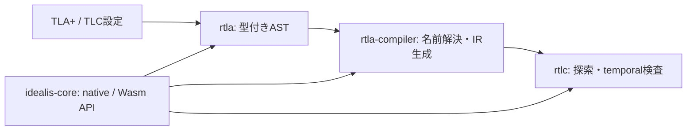

# RustだけでTLA+ソースを検査する

`compileTlaSource`と`checkTlaSource`は、idealis-coreのWasmでTLA+ソースを解析・変換・検査する。ブラウザとNodeで使え、tla-ts、Z3、JVMを必要としない。Rust nativeでは同じfrontendをlibraryとJSONLで使える。

```ts
import {
  createPortableWasm,
  compileTlaSource,
  checkTlaSource,
} from "@mizchi/idealis/portable";

const core = await createPortableWasm(wasmBytes);
const input = {
  source:
    "---- MODULE Counter ----\nEXTENDS Naturals\nVARIABLE x\nInit == x = 0\nNext == x' = x + 1\nSafe == x < 3\n====",
  config: "INIT Init\nNEXT Next\nINVARIANT Safe",
};
const program = compileTlaSource(core, input);
const result = checkTlaSource(core, input, {
  maxDepth: 10,
  maxStates: 100,
  maxWork: 10_000,
});
```

`program`は保存・再利用できるSafetyProgram。既存の`checkSafety`、nativeの並列API、`createRtlcBackend`にも渡せる。直接検査する場合は`checkTlaSource`を使う。ソースの構文・未対応fragment・評価のエラーはPortableCoreErrorとなり、空集合や予算切れへ変換しない。

## crateの境界



rtlaはparser、rtlcはIRとcheckerとして独立している。rtla-compilerが両方へ依存し、`compile(&Module, &Config)`でSafetyProgramを返す。idealis-coreの`compile_tla(source, config)`は解析と変換をまとめる。

```sh
cargo run --locked --manifest-path crates/rtla-compiler/Cargo.toml --example check
```

native JSONLでは`{"version":1,"request":{"kind":"compile-tla","source":"…","config":"…"}}`が`{"kind":"compiled","program":…}`を返す。`check-tla`は同じsource/configとboundsを受け、既存の`{"kind":"safety","result":…}`を返す。既存requestとWasm ABI v1を維持し、compilerだけが解析途中でホストへ戻ることもない。

## 対応範囲

目標は[既存の有限fragment](rust-safety.md#対応範囲)との一致。名前解決、定数、非再帰operator、lexicalなLET、有限量化、集合・関数・record・sequence、action列挙、temporal/fairnessを変換する。全TLA+やSANYの型検査ではない。INSTANCE、ユーザーモジュール、一般の高階・再帰operator、無限集合の列挙、symmetry、VIEWは未対応。

整数はTLC 1.7.4に合わせたsigned 32 bit。未使用の定義・theoremの正しさは保証しない。既存の`compileTlaSafety`はtla-tsを使う独立したfrontendとして残しており、自動で切り替えない。

CASEは式・actionともOTHERを省略でき、ソース順で最初の真のarmを選ぶ。OTHERがなく全条件が偽なら、TLC v1.7.4 (`5a47802`) に合わせて評価時に未一致エラーとソース位置を返す。未評価の分岐内のCASEではエラーにしない。両frontendで同じIRへ変換する。

root module が直接 `EXTENDS Apalache` を指定するときだけ、`ApaFoldSet(Op, v, S)` と `ApaFoldSeqLeft(Op, v, seq)` を扱う。`Op` は呼び出し位置で可視の top-level / LET 定義の非再帰 operator 名で、零 arity の引数をちょうど2つ持つ必要がある。累積値が第1引数、要素が第2引数。呼び出し位置で body を展開し、bound slot を2つ使う。一般の高階 operator は未対応のままで、この2つの fold の operator 名だけが例外。LAMBDA、operator parameter、再帰、他の Apalache operator は拒否する。`EXTENDS Apalache` がなければ fold 名も通常の名前解決に従う。展開深さ・bound variable の上限は変更しない。

sequence は先頭から処理し、文字列・record・関数を含む任意の要素種を扱う。集合 fold は TLC v1.7.4 (`5a47802`) の順序に合わせ、整数、Boolean、tuple / sequence、集合、整数 key の関数と、それらの再帰的な組み合わせを扱う。整数は数値順、Boolean は FALSE / TRUE、tuple / sequence と集合は要素数の後に再帰的な辞書順、関数は domain 要素数の後に各 key / value を交互に比較する。集合要素内の全整数 function key の最大値と最小値の差が `i32::MAX` を超える場合は拒否する。TLC の interval / 明示 domain 間の32-bit減算で順序が反転するためで、IR は元の domain 表現を区別しない。primitive 整数や関数の値にこの幅制限は課さない。domain が `1..n` の関数は既存の値表現どおり sequence として扱う。文字列・record をどの深さでも含む集合は、IR に TLC の文字列・field 名の intern ID がないため、それぞれ理由を明示した評価時エラーで拒否する。非整数 key のその他の関数は従来の `Unsupported TLA input: set fold order for strings, records or functions` を維持する。集合foldの model value は未対応で、異なる値種の比較が必要な集合も拒否する。[pinned TLC ログ](../evals/fixtures/tlc-apalache-folds/README.md)を対照にしており、Apalache 全体との互換性を表さない。

内部ではJSONのIR nodeを組み立て、型付きSafetyProgramへ変換する。今回の評価は意味の一致を確認するもので、TS frontendより高速という測定ではない。`complete`、`bounded`、`empty`の意味は従来と同じ。[backend契約](backend-contract.md)を使う場合も、検査対象・意味論・仮定のIDは呼び出し側で固定する。

## 検証

```sh
just compiler-test
just compiler-eval evals/runs/<新規ID>
just compiler-tlc evals/runs/<新規ID> /path/to/java /path/to/tla2tools.jar
just portable-test
just package
```

[0029の記録](../evals/iterations/0029-rtla-compiler.md)に、既存199入力のIR・native/Wasm結果、20件のTLC対照、実ブラウザとsolverを入れない単独consumerの検証を保存する。

Rust frontendとrtlcの追加対応は[crateのチェックリスト](../crates/rtla-compiler/SUPPORT.md)を参照。model value、有限CHOOSE、整数の\div / % / ^、CONSTRAINT / ACTION_CONSTRAINT、PROPERTY内の定数有限domain上の時間論理量化を扱う。既存TS frontendの対応範囲とは区別する。
