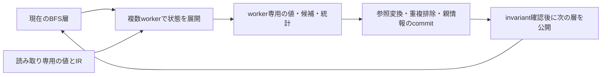

# TLCの内部並列化をmodeltへ取り入れる

TLCの状態単位の並列展開はmodeltへ取り入れられる。ただし、共有キューを追加するだけでは関数・recordの評価を並列化できない。現在のArenaが値の生成・intern・literal cache・work予算を共有可変データとして持つため、まず値の保持とworkerの評価用領域を分ける必要がある。nativeに層同期BFSの明示的な経路を実装した。既存Arenaを借用し、workerが作った値だけを統合する。初回の共有workカウンタ方式は遅くなったため、defaultは逐次のままにしている。[初回評価と制約](../evals/iterations/0020-frontier-safety.md)、[APIの使い方](rust-safety.md#nativeの並列探索)を参照。以下はTLCのソース調査と採用時の検討で、ブラウザ共有memoryやlivenessの内部並列化は未実装。

[単一モデルの実測](../evals/iterations/0019-single-model-scaling.md)では、TLCの1→8 workerで関数cubeが12.81→4.72 s、チャネル群が24.08→6.27 sになった。nativeは8.89 sと19.86 sなので、TLC 8 workerへ並ぶにはそれぞれ約1.9倍、約3.2倍の改善が必要。これは必要改善率であり、移植後の速度の予測ではない。

## TLC v1.7.4で確認した仕組み

調査対象は測定したjarと同じtag、commit `5a47802b5c391f59ecdd44117981f4ff8c0656ba`。masterの実装と混ぜない。

| 機構                     | 確認した動作                                                                                                               | modeltへ取り入れる点                                          |
| ------------------------ | -------------------------------------------------------------------------------------------------------------------------- | ------------------------------------------------------------- |
| 共有状態キュー           | 各WorkerがsDequeueで1状態を取り、Nextを展開する。Worker.runはwork stealingではない                                         | 独立した現在状態を並列展開する                                |
| 競合に対応した既訪問判定 | FPSet.putが既出か判定して登録する。HeapBasedDiskFPSetはstriped read/write lockで検索と挿入を同期し、書き込み時に再確認する | 全体を単一Mutexで囲まず、分割した索引で重複排除する           |
| worker専用領域           | FastToolとキュー・FPSetを共有し、生成数、outdegree、liveness用の一時集合、trace fileはWorkerが持つ                         | immutable IRとworker専用のscratch領域・統計を分ける           |
| 検査後の公開             | 新状態をtraceへ記録し、不変条件とaction propertyを確認してからsEnqueueする                                                 | 未検査状態を他workerへ渡さず、違反traceの親情報を先に確定する |
| 終了判定                 | キューが空で全workerが待機したときに終了できる。単に一瞬空になっただけでは終了しない                                       | キュー、実行中、未commitの結果、失敗を含めて終了を判断する    |

根拠は[Worker.run / addElement](https://github.com/tlaplus/tlaplus/blob/v1.7.4/tlatools/org.lamport.tlatools/src/tlc2/tool/Worker.java)、[StateQueue.isAvail](https://github.com/tlaplus/tlaplus/blob/v1.7.4/tlatools/org.lamport.tlatools/src/tlc2/tool/queue/StateQueue.java)、[HeapBasedDiskFPSet.put](https://github.com/tlaplus/tlaplus/blob/v1.7.4/tlatools/org.lamport.tlatools/src/tlc2/tool/fp/HeapBasedDiskFPSet.java)。別実装の[MultiFPSet](https://github.com/tlaplus/tlaplus/blob/v1.7.4/tlatools/org.lamport.tlatools/src/tlc2/tool/fp/MultiFPSet.java)にはfingerprintの上位ビットで複数setへ振り分ける方式もある。この存在から、今回MultiFPSetが使われたと断定はしない。

新状態の処理順は、状態の妥当性確認、既訪問判定と新状態の親情報記録、未訪問状態のinvariant検査、action property検査、キューへの公開となる。既訪問状態への遷移にもaction propertyを適用する。deadlockは新状態数ではなく、Nextが生成したsuccessorの有無で判断する。循環や自己遷移をdeadlockとして扱わない。

## 現在のmodeltとの違い

`crates/modelt-core/src/safety.rs`のSearchは、StateStore・nodes・Arena・result・graphを1つの所有者が更新する。状態はflatなScalar配列で保持し、hashが一致しても状態全体を比較する。`safety_values.rs`のArenaは複合値にローカルなScalar::Refを割り当てる。

複数Arenaの同じRef番号が同じ値を表すとは限らない。workerの出力をRef番号のまま混ぜると、別の集合や関数を同じ状態として扱う危険がある。状態をworker間で渡す際には、共有したcanonical IDを使うか、worker固有の参照を明示してcommit時に変換する必要がある。

TLCのfingerprintによる分割と同期は参考になる。一方、modeltでは現在の状態全体による等価性判定を保つ。hashだけで既訪問と判断する変更を同じ最適化として混ぜない。

## nativeで試す方式

最初は深さごとの同期を持つBFSを候補とする。現在の最短safety反例とmaxDepthの意味を保ちやすい。TLC型の非同期キューをそのまま移す場合は、異なる深さの処理が重なる状況と、最短反例の契約を別途検証する必要がある。

共有IRと既存値を読み取り専用で参照し、worker内の新しい値とwork集計はlocalに持つ。次の層のcommit時に値をcanonical化し、状態ID・親・action・depthを確定する。巨大なArena全体をworkerごとにcloneする方式や、すべての式評価をArenaの単一Mutex内で実行する方式は、最初の候補から外す。前者は複製費用、後者は直列化が問題になる。

この方式でも、mergeの費用、複合値の重複生成、invariantとaction propertyの評価順を検証する必要がある。特にpropertyを別フェーズへ移すことで、短絡評価やモデル評価エラーの扱いを変えてはいけない。最初の実験は今回のstate invariantを持つsafety fragmentへ限定し、未対応のpropertyは現行の逐次経路を使うことを明示する。

値の保持方式の変更と、thread数の効果は別々に測る。まず新しい保持方式の1 worker版を既存の逐次版と照合し、その後1/2/4/8 workerを比較する。counterのように単純な展開では並列化の費用が増える可能性があるため、少ない状態や安い展開では逐次を選べるようにする。scalarだけの試作が速くても、今回負けた関数・recordの改善としては採用しない。

## 予算と正しさの確認

- maxStatesはglobalな重複排除後の状態数で管理する。複数workerが同時に上限を越えてcommitしない。
- maxWorkはworkerごとの上限を単純に複製しない。全体で予約・消費を管理し、未使用分を返す方式を検討する。式評価ごとの単一atomic更新が律速にならないかも測る。
- 同じ層の全展開とcommitが済む前にcompleteへしない。worker故障・型エラー・予算切れ・未反映の候補を残した成功を拒否する。
- invariantとaction propertyを元の意味どおりに評価する。未検査状態の公開、短絡評価の変更、モデル評価エラーの隠蔽を拒否する。
- 全辺・actionを保存する必要があるlivenessは別段階。既訪問targetへの辺も残し、現行のglobal SCCへ渡す。partitionを跨ぐ循環やWF/SFを、各workerの局所結果だけで合格にしない。

追加する対照は、同一targetへ同時に到達するdiamond、キューが空でもworkerが展開中の状態、同じlocal Ref番号を持つ異なる値、hash衝突、maxStates/maxWorkの境界、遅い短経路と速い長経路の違反、worker停止と型エラー。既存のTLC差分ケースも再実行し、状態数・生成数・違反の再生・最短性・bounded/empty/errorを確認する。性能評価には0019の4入力をそのまま使う。

## ブラウザへの展開

nativeのthread poolは先に試せる。現在の`wasm32-unknown-unknown`は通常のstd::thread::spawnをそのまま使えず、Rust公式文書でもpanicするAPIとして扱われる。[Rust target文書](https://doc.rust-lang.org/rustc/platform-support/wasm32-unknown-unknown.html)

現在のWasm ABIはhost importなしのinstanceとthread-localなEngineを前提にしており、既存binaryのmemoryを複数workerへ渡すだけでは並列版にならない。共有memoryを使う場合は、同期・初期化とhost側のworker起動を含む別のbuild/adapterが必要。ブラウザのSharedArrayBufferにはsecure contextとcross-origin isolationの要件がある。[MDN](https://developer.mozilla.org/en-US/docs/Web/JavaScript/Reference/Global_Objects/SharedArrayBuffer)

共有memoryなしのmessage passingも候補だが、巨大な値や状態の転送費用を実測する必要がある。現在の独立検査poolと逐次Wasmは維持し、単一モデルの並列化は利用環境に応じた追加経路として検証する。初期の採用対象はnativeのsafety探索とし、速度向上は試作を測るまで断定しない。
